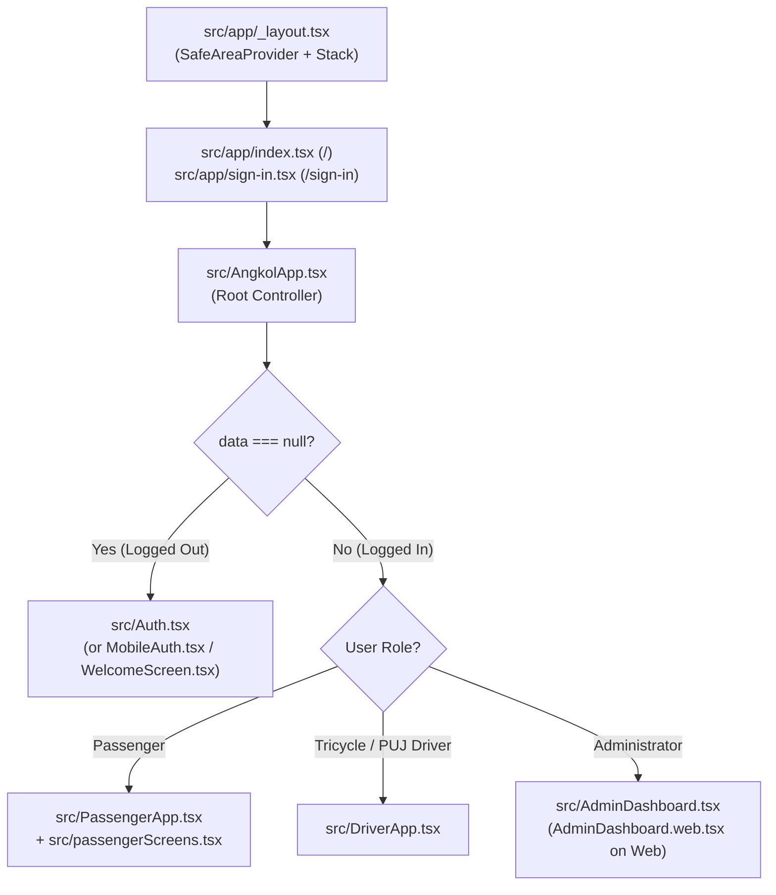
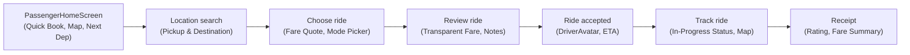
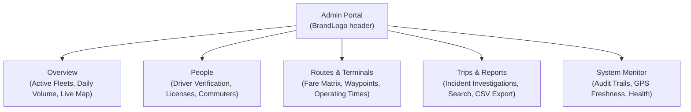

# Angkol Frontend (`src/`) Process Flow, File Responsibilities & Page Directory

This document provides a comprehensive architectural breakdown of the **`src/`** directory in the Angkol static prototype application. It outlines the simplified structural hierarchy, end-to-end user and data process flows, file-by-file responsibilities, a directory of all detected pages/screens, and a comparative gap analysis against the project's Software Requirements Specification (SRS v1.0.0).

---

## 1. Logical Folder & Component Hierarchy

For architectural clarity, the **29 files** within `src/` (including the `src/app/` router directory) are organized into logical domain layers below:

```
src/
├── [1] Navigation & Entrypoint Layer (Expo Router)
│   ├── app/_layout.tsx                 # Root layout, SafeAreaProvider, and Stack navigator
│   ├── app/index.tsx                   # Root entry route (/) re-exporting AngkolApp
│   └── app/sign-in.tsx                 # Dedicated sign-in route (/sign-in) re-exporting AngkolApp
│
├── [2] Application Orchestration & Root State
│   └── AngkolApp.tsx                   # Main state container, API synchronization & role dispatch
│
├── [3] Authentication & Onboarding Layer
│   ├── Auth.tsx                        # Platform router (Web Admin login vs. native MobileAuth)
│   ├── MobileAuth.tsx                  # Native mobile authentication & multi-step signup wizard
│   ├── WelcomeScreen.tsx               # Aerial hero welcome/splash landing screen with "Get started" CTA
│   └── sampleAccounts.ts               # Demo credentials catalog & in-memory authentication handler
│
├── [4] Role-Based Application Interfaces (Pages & Flows)
│   ├── Passenger Domain
│   │   ├── PassengerApp.tsx            # Commuter booking, trip tracking, route explorer coordinator
│   │   └── passengerScreens.tsx        # Modular passenger sub-screens (Home, Routes, Trips, Profile)
│   ├── Driver Domain
│   │   └── DriverApp.tsx               # Tricycle hail & PUJ corridor runs, earnings & vehicle log
│   └── Administrator Domain
│       ├── AdminDashboard.tsx          # Mobile preview administrator wrapper
│       ├── AdminDashboard.web.tsx      # Comprehensive multi-page desktop web admin portal
│       └── AdminPanel.tsx              # Shared fare matrix & route/terminal configuration forms
│
├── [5] Geospatial & Map Layer
│   ├── CalbayogMap.tsx                 # Map wrapper export
│   ├── StaticMap.tsx                   # Local offline map with interactive coordinate touch picking
│   └── mapTypes.ts                     # TypeScript props and interfaces for map interactions
│
├── [6] In-Memory Mock Backend & Simulated Actions
│   ├── api.ts                          # Mock REST API engine & in-memory state store
│   ├── sampleAdministratorData.ts      # Administrative fixture generator (drivers, logs, stats)
│   ├── sampleDriverData.ts             # Driver shifts, run logs & 7-day earnings fixtures
│   ├── sampleTrips.ts                  # Calbayog landmark routes & trip history templates
│   └── previewActions.ts               # Prototype action stubs (Share dialog, Linking/Calls, Photo picker)
│
├── [7] Presentation, Design System & Custom Components
│   ├── BrandLogo.tsx                   # Scalable vector-aligned brand artwork & wordmark renderer
│   ├── DriverAvatar.tsx                # Driver photo renderer with automatic initial fallback
│   ├── ui.tsx                          # Base UI kit (Button, Card, Field, Icon, Badge, Heading)
│   ├── styles.ts                       # Shared base styling rules and color tokens
│   ├── passengerStyles.ts              # Mobile-first design tokens for Passenger and Driver apps
│   └── adminDashboardStyles.ts         # Desktop web styles for administrator tables and panels
│
└── [8] Domain Model Definitions
    └── types.ts                        # Global TypeScript types (User, Trip, Route, Snapshot, etc.)
```

---

## 2. End-to-End Process Flows

### 2.1 Bootstrapping & Initialization Flow
1. **App Mount**: Expo Router initializes [`src/app/_layout.tsx`](file:///c:/Users/alizz/Downloads/SoftEng/Angkol/src/app/_layout.tsx), mounting the root `SafeAreaProvider` and a headerless `<Stack />`.
2. **Route Resolution**:
   - Navigating to `/` triggers [`src/app/index.tsx`](file:///c:/Users/alizz/Downloads/SoftEng/Angkol/src/app/index.tsx).
   - Navigating to `/sign-in` triggers [`src/app/sign-in.tsx`](file:///c:/Users/alizz/Downloads/SoftEng/Angkol/src/app/sign-in.tsx).
   - Both routes delegate execution to [`src/AngkolApp.tsx`](file:///c:/Users/alizz/Downloads/SoftEng/Angkol/src/AngkolApp.tsx).
3. **Session Check**: [`AngkolApp.tsx`](file:///c:/Users/alizz/Downloads/SoftEng/Angkol/src/AngkolApp.tsx) checks its internal `data` state (`Snapshot | null`). If `data === null`, the user is unauthenticated; the app displays [`src/Auth.tsx`](file:///c:/Users/alizz/Downloads/SoftEng/Angkol/src/Auth.tsx).



---

### 2.2 Authentication, Onboarding & Demo Sign-In Flow
1. **Splash & Welcome Presentation**: [`src/WelcomeScreen.tsx`](file:///c:/Users/alizz/Downloads/SoftEng/Angkol/src/WelcomeScreen.tsx) displays an aerial view of Calbayog City, platform mission statement, and a "Get started" button.
2. **Device Detection**: [`src/Auth.tsx`](file:///c:/Users/alizz/Downloads/SoftEng/Angkol/src/Auth.tsx) checks `Platform.OS`.
   - On native mobile (iOS / Android), it routes rendering to [`src/MobileAuth.tsx`](file:///c:/Users/alizz/Downloads/SoftEng/Angkol/src/MobileAuth.tsx).
   - On desktop web, it displays the Administrator portal login card with the [`src/BrandLogo.tsx`](file:///c:/Users/alizz/Downloads/SoftEng/Angkol/src/BrandLogo.tsx) icon.
3. **Account Selection / Submission**:
   - Quick demo logins are provided via [`src/sampleAccounts.ts`](file:///c:/Users/alizz/Downloads/SoftEng/Angkol/src/sampleAccounts.ts): `Isabella Reyes` (Passenger), `Miguel Santos` (Tricycle driver), `Rafael Mendoza` (PUJ / PUV driver), and `Patricia Villanueva` (Administrator).
   - For new accounts, [`src/MobileAuth.tsx`](file:///c:/Users/alizz/Downloads/SoftEng/Angkol/src/MobileAuth.tsx) walks through a 2-step registration wizard (Step 1: credentials & role selection; Step 2: driver license, association, plate details, and terms agreement).
4. **Session Population**:
   - Invokes [`selectDemo(role)`](file:///c:/Users/alizz/Downloads/SoftEng/Angkol/src/api.ts#L46) in [`src/api.ts`](file:///c:/Users/alizz/Downloads/SoftEng/Angkol/src/api.ts), building the in-memory mock `state`.
   - Triggers `refresh()` in [`src/AngkolApp.tsx`](file:///c:/Users/alizz/Downloads/SoftEng/Angkol/src/AngkolApp.tsx), loading `GET /state` and initiating the role view switch.

---

### 2.3 Commuter / Passenger Process Flow ([`PassengerApp.tsx`](file:///c:/Users/alizz/Downloads/SoftEng/Angkol/src/PassengerApp.tsx) & [`passengerScreens.tsx`](file:///c:/Users/alizz/Downloads/SoftEng/Angkol/src/passengerScreens.tsx))
The passenger workflow is coordinated by [`src/PassengerApp.tsx`](file:///c:/Users/alizz/Downloads/SoftEng/Angkol/src/PassengerApp.tsx) and modularized via [`src/passengerScreens.tsx`](file:///c:/Users/alizz/Downloads/SoftEng/Angkol/src/passengerScreens.tsx) using URL query parameters (`screen=...`):



1. **Home Screen (`PassengerHomeScreen`)**: Displays map overview, quick book options, next corridor departure times, and active trip status banners.
2. **Location Search**: Commuter selects pickup and destination points using search inputs or tapping directly on [`src/StaticMap.tsx`](file:///c:/Users/alizz/Downloads/SoftEng/Angkol/src/StaticMap.tsx).
3. **Choose Ride**: Queries `POST /quote` with coordinates to calculate distance, duration, and local base fare rules (regulated under Calbayog City fare ordinances).
4. **Review & Book**: Commuter reviews pickup notes, luggage options, and payment details; submits `POST /trips` to create a ride request.
5. **Ride Accepted & In-Progress**: Shows assigned driver (`Miguel Santos`) rendered with [`src/DriverAvatar.tsx`](file:///c:/Users/alizz/Downloads/SoftEng/Angkol/src/DriverAvatar.tsx), vehicle plate, association, and contact actions via [`src/previewActions.ts`](file:///c:/Users/alizz/Downloads/SoftEng/Angkol/src/previewActions.ts).
6. **Receipt & Feedback**: Displays itemized fare breakdown and 5-star driver rating input with `POST /trips/:id/rate`.
7. **Secondary Commuter Views**:
   - **Routes Screen (`PassengerRoutesScreen`)**: Scheduled transit corridors (City Hall – Public Market, Airport corridor), stops, operating hours, and intervals.
   - **Trips Screen (`PassengerTripsScreen`)**: Ride history with filters (All trips, Completed, Cancelled).
   - **Profile Screen (`PassengerProfileScreen`)**: Account preferences, verified badge, and contact settings.
   - **Terminals & Support**: Terminal locations and grievance/safety incident ticket submission.

---

### 2.4 Driver Process Flow ([`DriverApp.tsx`](file:///c:/Users/alizz/Downloads/SoftEng/Angkol/src/DriverApp.tsx))
[`src/DriverApp.tsx`](file:///c:/Users/alizz/Downloads/SoftEng/Angkol/src/DriverApp.tsx) adapts automatically based on whether the logged-in user is a **Tricycle driver** (point-to-point on-demand) or a **PUJ / PUV driver** (fixed corridor run):

#### A. Tricycle Driver Flow (On-Demand Hailing)
1. **Dashboard**: Toggle online availability and location sharing; view pending passenger requests.
2. **Requests Screen**: Inspects incoming ride requests with pickup/destination landmarks and fare amount.
3. **Trip Execution**:
   - `Accept Ride`: Driver accepts request (`PATCH /trips/:id` status: `Accepted`).
   - `Pickup`: Navigates to commuter; marks status as `Arrived`, then `In progress` once boarded.
   - `Complete`: Marks ride `Completed`, collects cash fare, and returns to Dashboard.

#### B. PUJ / PUV Driver Flow (Corridor Runs & Passenger Counting)
1. **Corridor Assignment**: Driver is bound to a franchise route (e.g., `CB01: City Hall – Public Market`).
2. **Start Run**: Dispatches `POST /runs` to start a scheduled corridor trip.
3. **Stops & Boarding Counts**: At each designated stop or terminal, driver adjusts boarded and alighted passenger tallies (`PATCH /runs/:id/stop`).
4. **Terminal Queue**: Driver checks into terminal queues (`POST /terminals/:id/queue`).
5. **End Run**: Closes the run (`PATCH /runs/:id/end`), logging total passenger counts, gross fares collected, and fuel costs.

#### C. Shared Driver Tools
- **Driver Avatar & Photo**: Uses [`src/DriverAvatar.tsx`](file:///c:/Users/alizz/Downloads/SoftEng/Angkol/src/DriverAvatar.tsx) and photo picker in [`src/previewActions.ts`](file:///c:/Users/alizz/Downloads/SoftEng/Angkol/src/previewActions.ts).
- **Records**: Shift-by-shift run history and completed trip receipts.
- **Earnings**: 7-day revenue visualization, gross earnings, net payouts, and deductions.
- **Documents & Profile**: Review franchise credentials, registration expiration, and association standing.

---

### 2.5 Administrator Management Flow ([`AdminDashboard.web.tsx`](file:///c:/Users/alizz/Downloads/SoftEng/Angkol/src/AdminDashboard.web.tsx) & [`AdminPanel.tsx`](file:///c:/Users/alizz/Downloads/SoftEng/Angkol/src/AdminPanel.tsx))
The administrator interface oversees the entire Calbayog City transport ecosystem through five integrated sections:



1. **Operations Overview**: High-level KPIs (active drivers, passenger trips today, fare totals), real-time map with vehicle pins, and recent audit logs. Features branding via [`src/BrandLogo.tsx`](file:///c:/Users/alizz/Downloads/SoftEng/Angkol/src/BrandLogo.tsx).
2. **People & Verification**: Approves or revokes driver licenses, verifies transport association memberships, and inspects vehicle passenger capacities.
3. **Routes, Terminals & Fares**:
   - Configures official tricycle fare matrix (base fare, per-km rate, official ordinance reference).
   - Creates and updates fixed PUJ routes, stops, schedules, intervals, and terminal coordinates using [`src/AdminPanel.tsx`](file:///c:/Users/alizz/Downloads/SoftEng/Angkol/src/AdminPanel.tsx).
4. **Trips & Reports**: Audits trip history, reads passenger grievance reports, reviews safety incidents, and exports data to CSV.
5. **System & Audit Monitor**: Inspects telemetry freshness, simulated system latency, security events, and administrative mutation logs.

---

### 2.6 Data Mutation & In-Memory Synchronization Flow ([`api.ts`](file:///c:/Users/alizz/Downloads/SoftEng/Angkol/src/api.ts) & [`previewActions.ts`](file:///c:/Users/alizz/Downloads/SoftEng/Angkol/src/previewActions.ts))
1. **Mock Endpoints**: All network calls in [`src/api.ts`](file:///c:/Users/alizz/Downloads/SoftEng/Angkol/src/api.ts) operate strictly in-memory without Firebase or remote backends.
2. **Action Dispatch**: Components invoke `action(endpoint, payload, method)` defined in [`src/AngkolApp.tsx`](file:///c:/Users/alizz/Downloads/SoftEng/Angkol/src/AngkolApp.tsx).
3. **State Mutation**: [`src/api.ts`](file:///c:/Users/alizz/Downloads/SoftEng/Angkol/src/api.ts) updates the local `state` object.
4. **Snapshot Refresh**: [`src/AngkolApp.tsx`](file:///c:/Users/alizz/Downloads/SoftEng/Angkol/src/AngkolApp.tsx) calls `refresh()`, pulling `GET /state` and distributing the updated `Snapshot` to all child components via props.
5. **Simulated Device Integrations**: External interactions (Sharing, Phone dialing, Photo picking) are intercepted safely by [`src/previewActions.ts`](file:///c:/Users/alizz/Downloads/SoftEng/Angkol/src/previewActions.ts) to prevent native crashes in demo environments.

---

## 3. Detailed File Responsibilities

Below is an alphabetical breakdown of all **29 source files** inside `src/`:

### 1. [`src/AdminDashboard.tsx`](file:///c:/Users/alizz/Downloads/SoftEng/Angkol/src/AdminDashboard.tsx)
- **Role**: Mobile Administrator Fallback Screen.
- **Responsibilities**:
  - Renders a clean mobile-friendly container for administrator management on small screens.
  - Mounts [`AdminPanel.tsx`](file:///c:/Users/alizz/Downloads/SoftEng/Angkol/src/AdminPanel.tsx) with action dispatchers and provides a quick logout/exit preview button.

### 2. [`src/AdminDashboard.web.tsx`](file:///c:/Users/alizz/Downloads/SoftEng/Angkol/src/AdminDashboard.web.tsx)
- **Role**: Full Desktop Web Administration Dashboard.
- **Responsibilities**:
  - Renders a comprehensive web portal with a sidebar, stat cards, interactive maps, and responsive data tables.
  - Uses [`src/BrandLogo.tsx`](file:///c:/Users/alizz/Downloads/SoftEng/Angkol/src/BrandLogo.tsx) in sidebar headers.
  - Manages five sub-pages: `Overview`, `People`, `Routes & terminals`, `Trips & reports`, and `System monitor`.
  - Supports driver verification actions, fare ordinance editing, route updates, and CSV reporting export.

### 3. [`src/adminDashboardStyles.ts`](file:///c:/Users/alizz/Downloads/SoftEng/Angkol/src/adminDashboardStyles.ts)
- **Role**: Styling Suite for Web Administrator Interface.
- **Responsibilities**:
  - Provides CSS-in-JS style rules for the web layout: sidebar grid, KPI metric cards, data tables, status badges, and action buttons.

### 4. [`src/AdminPanel.tsx`](file:///c:/Users/alizz/Downloads/SoftEng/Angkol/src/AdminPanel.tsx)
- **Role**: Reusable Transport Configuration Component.
- **Responsibilities**:
  - Form controls for modifying the Tricycle fare matrix (base fare, per-km charge, council ordinance reference, approval status).
  - Route and terminal creation/editing forms (stops, departure intervals, start/end hours, coordinates).

### 5. [`src/AngkolApp.tsx`](file:///c:/Users/alizz/Downloads/SoftEng/Angkol/src/AngkolApp.tsx)
- **Role**: Central App Coordinator & Session State Manager.
- **Responsibilities**:
  - Manages root state: active `Snapshot`, user alerts/notices, and driver location sharing status.
  - Exposes `refresh()`, `action()`, and `logout()` handlers.
  - Dispatches to the correct interface based on user role (`Administrator`, `Passenger`, or `Driver`).

### 6. [`src/api.ts`](file:///c:/Users/alizz/Downloads/SoftEng/Angkol/src/api.ts)
- **Role**: Mock API Engine & In-Memory Data Store.
- **Responsibilities**:
  - Simulates backend REST routes (`/state`, `/auth`, `/trips`, `/routes`, `/terminals`, `/fare`, `/profile`, `/runs`).
  - Implements route geometry calculations, fare formulas, terminal queueing, and role-based demo bootstrapping (`selectDemo()`).

### 7. [`src/app/_layout.tsx`](file:///c:/Users/alizz/Downloads/SoftEng/Angkol/src/app/_layout.tsx)
- **Role**: Expo Router Root Layout.
- **Responsibilities**:
  - Sets up `SafeAreaProvider`, status bar theme, and the top-level Expo Router headerless `<Stack />`.

### 8. [`src/app/index.tsx`](file:///c:/Users/alizz/Downloads/SoftEng/Angkol/src/app/index.tsx)
- **Role**: Expo Router Root Screen Route (`/`).
- **Responsibilities**:
  - Serves as the primary application entrypoint, re-exporting `AngkolApp` from `../AngkolApp`.

### 9. [`src/app/sign-in.tsx`](file:///c:/Users/alizz/Downloads/SoftEng/Angkol/src/app/sign-in.tsx)
- **Role**: Dedicated Expo Router Sign-In Route (`/sign-in`).
- **Responsibilities**:
  - Provides a direct URL route for user authentication, re-exporting `AngkolApp` from `../AngkolApp`.

### 10. [`src/Auth.tsx`](file:///c:/Users/alizz/Downloads/SoftEng/Angkol/src/Auth.tsx)
- **Role**: Platform-Adaptive Authentication Wrapper.
- **Responsibilities**:
  - Detects native vs. web platforms; renders [`MobileAuth.tsx`](file:///c:/Users/alizz/Downloads/SoftEng/Angkol/src/MobileAuth.tsx) on mobile devices.
  - Renders desktop web sign-in layout with [`src/BrandLogo.tsx`](file:///c:/Users/alizz/Downloads/SoftEng/Angkol/src/BrandLogo.tsx) and sample account picker.

### 11. [`src/BrandLogo.tsx`](file:///c:/Users/alizz/Downloads/SoftEng/Angkol/src/BrandLogo.tsx)
- **Role**: Brand Logo Artwork Renderer.
- **Responsibilities**:
  - Renders high-resolution brand artwork (`assets/angkol-icon.png` and `assets/angkol-title.png`), automatically cropping canvas margins.
  - Supports configurable rendering options: `compact` and `iconOnly`.

### 12. [`src/CalbayogMap.tsx`](file:///c:/Users/alizz/Downloads/SoftEng/Angkol/src/CalbayogMap.tsx)
- **Role**: Map Module Forwarder.
- **Responsibilities**:
  - Cleanly re-exports [`StaticMap.tsx`](file:///c:/Users/alizz/Downloads/SoftEng/Angkol/src/StaticMap.tsx) as the default mapping component.

### 13. [`src/DriverApp.tsx`](file:///c:/Users/alizz/Downloads/SoftEng/Angkol/src/DriverApp.tsx)
- **Role**: Driver Application Portal (Tricycle & PUJ/PUV).
- **Responsibilities**:
  - Internal routing for 15 driver pages/views via URL params (`screen`).
  - Integrates [`src/DriverAvatar.tsx`](file:///c:/Users/alizz/Downloads/SoftEng/Angkol/src/DriverAvatar.tsx) for driver photo and [`src/previewActions.ts`](file:///c:/Users/alizz/Downloads/SoftEng/Angkol/src/previewActions.ts) for platform previews.
  - Handles ride request acceptance, arrival notices, passenger boarding tallies, run completions, terminal queues, earnings graphs, and driver profile settings.

### 14. [`src/DriverAvatar.tsx`](file:///c:/Users/alizz/Downloads/SoftEng/Angkol/src/DriverAvatar.tsx)
- **Role**: Reusable Driver Avatar Component.
- **Responsibilities**:
  - Displays driver profile pictures from base64/data URIs with fallback to monogram initials.
  - Configurable circle dimension via `size` prop.

### 15. [`src/mapTypes.ts`](file:///c:/Users/alizz/Downloads/SoftEng/Angkol/src/mapTypes.ts)
- **Role**: Map Type Definitions.
- **Responsibilities**:
  - Declares interfaces for map rendering: `MapProps`, pickup/destination selections, landmark pins, terminal markers, and vehicle positions.

### 16. [`src/MobileAuth.tsx`](file:///c:/Users/alizz/Downloads/SoftEng/Angkol/src/MobileAuth.tsx)
- **Role**: Mobile Authentication & Registration Wizard.
- **Responsibilities**:
  - Multi-step sign-up flow for Commuters and Drivers (Tricycle & PUJ).
  - Form validation for phone numbers, email, passwords, vehicle plates, associations, and legal consent checkboxes.
  - Quick-switch demo account buttons for prototype evaluation.

### 17. [`src/PassengerApp.tsx`](file:///c:/Users/alizz/Downloads/SoftEng/Angkol/src/PassengerApp.tsx)
- **Role**: Commuter / Passenger Mobile Application Coordinator.
- **Responsibilities**:
  - Internal routing for 15 passenger pages/views via URL params (`screen`).
  - Delegates major views to [`src/passengerScreens.tsx`](file:///c:/Users/alizz/Downloads/SoftEng/Angkol/src/passengerScreens.tsx) (`PassengerHomeScreen`, `PassengerRoutesScreen`, `PassengerTripsScreen`, `PassengerProfileScreen`).
  - Integrates [`src/DriverAvatar.tsx`](file:///c:/Users/alizz/Downloads/SoftEng/Angkol/src/DriverAvatar.tsx) and [`src/previewActions.ts`](file:///c:/Users/alizz/Downloads/SoftEng/Angkol/src/previewActions.ts).
  - Manages point-to-point ride booking, fare quoting, driver matching, ride tracking, feedback ratings, transit schedule viewing, and terminal directories.

### 18. [`src/passengerScreens.tsx`](file:///c:/Users/alizz/Downloads/SoftEng/Angkol/src/passengerScreens.tsx)
- **Role**: Modular Passenger Sub-Screens.
- **Responsibilities**:
  - Provides modularized, high-fidelity views for core commuter workflows:
    - `PassengerHomeScreen`: Hero cards, quick actions, nearby transit, next departure countdown.
    - `PassengerRoutesScreen`: Interactive corridor explorer with stop lists and schedules.
    - `PassengerTripsScreen`: Filtered trip history (All, Completed, Cancelled).
    - `PassengerProfileScreen`: User preferences, saved places, safety emergency contacts, and account settings.

### 19. [`src/passengerStyles.ts`](file:///c:/Users/alizz/Downloads/SoftEng/Angkol/src/passengerStyles.ts)
- **Role**: Mobile Design System for Commuter & Driver UIs.
- **Responsibilities**:
  - Exports `ps` StyleSheet and `passengerColors` palette (`#176B48` emerald green, `#FAFAF7` background, rounded cards, input fields, pill buttons).

### 20. [`src/previewActions.ts`](file:///c:/Users/alizz/Downloads/SoftEng/Angkol/src/previewActions.ts)
- **Role**: Prototype Platform Action Interceptor.
- **Responsibilities**:
  - Mocks device-specific platform interactions safely inside the prototype:
    - `Share.share`: Simulated sharing dialog.
    - `Linking.openURL`: Simulated call/contact/directions URL launcher dialog.
    - `pickDriverPhoto`: Simulated local driver photo selector.

### 21. [`src/sampleAccounts.ts`](file:///c:/Users/alizz/Downloads/SoftEng/Angkol/src/sampleAccounts.ts)
- **Role**: Fixture Account Catalog & Mock Authentication Service.
- **Responsibilities**:
  - Stores demo account credentials for Isabella Reyes, Miguel Santos, Rafael Mendoza, and Patricia Villanueva.
  - Implements `signInSampleAccount()` and `registerSampleAccount()`.

### 22. [`src/sampleAdministratorData.ts`](file:///c:/Users/alizz/Downloads/SoftEng/Angkol/src/sampleAdministratorData.ts)
- **Role**: Administrator Fixture Data Generator.
- **Responsibilities**:
  - Generates realistic mock collections for admin screens: sample commuters, verified drivers, active vehicle locations, route lists, and audit log entries.

### 23. [`src/sampleDriverData.ts`](file:///c:/Users/alizz/Downloads/SoftEng/Angkol/src/sampleDriverData.ts)
- **Role**: Driver Fixture Data Generator.
- **Responsibilities**:
  - Populates driver history: 7-day completed trips, PUJ corridor passenger counts, and simulated earnings totals.

### 24. [`src/sampleTrips.ts`](file:///c:/Users/alizz/Downloads/SoftEng/Angkol/src/sampleTrips.ts)
- **Role**: Commuter Trip Fixtures & Landmark Generator.
- **Responsibilities**:
  - Defines Calbayog City landmarks (City Hall, Public Market, Calbayog Airport, Nijaga Park, SSU).
  - Generates realistic active, completed, and cancelled trip templates with mock geometry paths.

### 25. [`src/StaticMap.tsx`](file:///c:/Users/alizz/Downloads/SoftEng/Angkol/src/StaticMap.tsx)
- **Role**: Offline Static Map Component.
- **Responsibilities**:
  - Displays a high-resolution bundled raster image of Calbayog City.
  - Provides interactive touch areas allowing users to pick coordinates for pickup and destination without external map tile requests.

### 26. [`src/styles.ts`](file:///c:/Users/alizz/Downloads/SoftEng/Angkol/src/styles.ts)
- **Role**: Shared Application Styles.
- **Responsibilities**:
  - Defines common style tokens (`s`) for cards, headings, choice chips, input containers, and brand logos.

### 27. [`src/types.ts`](file:///c:/Users/alizz/Downloads/SoftEng/Angkol/src/types.ts)
- **Role**: Core TypeScript Type Declarations.
- **Responsibilities**:
  - Defines data contracts used across the entire prototype: `Role`, `User`, `Point`, `Geometry`, `Status`, `Quote`, `Trip`, `DriverRun`, `Route`, `Terminal`, `Vehicle`, `AuditLog`, and `Snapshot`.

### 28. [`src/ui.tsx`](file:///c:/Users/alizz/Downloads/SoftEng/Angkol/src/ui.tsx)
- **Role**: Shared Primitives & UI Atoms.
- **Responsibilities**:
  - Reusable presentation components: `Button`, `Card`, `Field`, `Choice`, `Heading`, `Badge`, `Icon` (Ionicons wrapper), and `money()` Philippine Peso currency formatter.

### 29. [`src/WelcomeScreen.tsx`](file:///c:/Users/alizz/Downloads/SoftEng/Angkol/src/WelcomeScreen.tsx)
- **Role**: Splash & Onboarding Welcome Screen.
- **Responsibilities**:
  - Renders a visually rich landing screen with an aerial portrait of Calbayog City (`assets/calbayog-welcome-portrait.png`).
  - Displays city badge ("CALBAYOG CITY, SAMAR"), app title, and a prominent "Get started" button triggering user onboarding.

---

## 4. Page Detection Directory: What and Where Pages Are

The application uses a hybrid routing model: **Expo Router** handles the physical top-level routes (`/` and `/sign-in`), while in-app sub-screens are virtualized and routed via Expo Router query parameters (`screen=...` via `useLocalSearchParams()`) to maintain fast, stateful prototype transitions.

Below is the directory of all detected pages across the prototype:

### 4.1 Physical Expo Router Pages
| Physical File Path | Route Path | Component | Purpose |
|---|---|---|---|
| [`src/app/_layout.tsx`](file:///c:/Users/alizz/Downloads/SoftEng/Angkol/src/app/_layout.tsx) | `*` (Navigator) | `Layout` | Global container with `SafeAreaProvider`, `StatusBar`, and `<Stack />`. |
| [`src/app/index.tsx`](file:///c:/Users/alizz/Downloads/SoftEng/Angkol/src/app/index.tsx) | `/` | `AngkolApp` | Top-level entry route coordinating authentication and role views. |
| [`src/app/sign-in.tsx`](file:///c:/Users/alizz/Downloads/SoftEng/Angkol/src/app/sign-in.tsx) | `/sign-in` | `AngkolApp` | Dedicated direct sign-in route coordinating authentication. |

---

### 4.2 Onboarding, Splash & Authentication Pages
Rendered by [`src/WelcomeScreen.tsx`](file:///c:/Users/alizz/Downloads/SoftEng/Angkol/src/WelcomeScreen.tsx), [`src/Auth.tsx`](file:///c:/Users/alizz/Downloads/SoftEng/Angkol/src/Auth.tsx), and [`src/MobileAuth.tsx`](file:///c:/Users/alizz/Downloads/SoftEng/Angkol/src/MobileAuth.tsx):

| Screen / Step | File & Container | Trigger / State | Purpose |
|---|---|---|---|
| **Welcome / Splash Screen** | [`src/WelcomeScreen.tsx`](file:///c:/Users/alizz/Downloads/SoftEng/Angkol/src/WelcomeScreen.tsx) | Initial Unauthenticated View | Aerial Calbayog City backdrop with brand mission and "Get started" button. |
| **Web Admin Login** | [`src/Auth.tsx`](file:///c:/Users/alizz/Downloads/SoftEng/Angkol/src/Auth.tsx) | `Platform.OS === 'web'` | Administrator credential input and demo account picker with `BrandLogo`. |
| **Mobile Sign In** | [`src/MobileAuth.tsx`](file:///c:/Users/alizz/Downloads/SoftEng/Angkol/src/MobileAuth.tsx) | `!signup` | Commuter and driver mobile login screen. |
| **Mobile Sign Up (Step 1)** | [`src/MobileAuth.tsx`](file:///c:/Users/alizz/Downloads/SoftEng/Angkol/src/MobileAuth.tsx) | `signup && step === 1` | Name, phone, email, password, and role selection (Commuter vs Driver). |
| **Mobile Sign Up (Step 2)** | [`src/MobileAuth.tsx`](file:///c:/Users/alizz/Downloads/SoftEng/Angkol/src/MobileAuth.tsx) | `signup && step === 2` | Vehicle type, license number, plate, association, and terms acknowledgment. |

---

### 4.3 Passenger / Commuter Pages
Rendered inside [`src/PassengerApp.tsx`](file:///c:/Users/alizz/Downloads/SoftEng/Angkol/src/PassengerApp.tsx) and [`src/passengerScreens.tsx`](file:///c:/Users/alizz/Downloads/SoftEng/Angkol/src/passengerScreens.tsx) based on `screen` param:

| Screen Name | Query Parameter (`screen=`) | Implementation Component | Purpose |
|---|---|---|---|
| **Home** | `Home` (Default) | `PassengerHomeScreen` in [`passengerScreens.tsx`](file:///c:/Users/alizz/Downloads/SoftEng/Angkol/src/passengerScreens.tsx) | Main commuter dashboard with map, quick book buttons, and next corridor departure. |
| **Journey** | `Journey` | [`PassengerApp.tsx`](file:///c:/Users/alizz/Downloads/SoftEng/Angkol/src/PassengerApp.tsx) | Overview of current origin, destination, and selected transit corridor. |
| **Location search** | `Location search` | [`PassengerApp.tsx`](file:///c:/Users/alizz/Downloads/SoftEng/Angkol/src/PassengerApp.tsx) | Search and selection of pickup and destination landmarks on Calbayog map. |
| **Choose ride** | `Choose ride` | [`PassengerApp.tsx`](file:///c:/Users/alizz/Downloads/SoftEng/Angkol/src/PassengerApp.tsx) | View fare estimates, trip durations, and select tricycle or public transit mode. |
| **Review ride** | `Review ride` | [`PassengerApp.tsx`](file:///c:/Users/alizz/Downloads/SoftEng/Angkol/src/PassengerApp.tsx) | Review fare transparency breakdown, pickup notes, and confirm ride request. |
| **Ride accepted** | `Ride accepted` | [`PassengerApp.tsx`](file:///c:/Users/alizz/Downloads/SoftEng/Angkol/src/PassengerApp.tsx) | Driver assigned banner, ETA countdown, `DriverAvatar`, and driver contact info. |
| **Track ride** | `Track ride` | [`PassengerApp.tsx`](file:///c:/Users/alizz/Downloads/SoftEng/Angkol/src/PassengerApp.tsx) | Live in-progress ride status, landmark progress indicators, and cancel/contact options. |
| **Receipt** | `Receipt` | [`PassengerApp.tsx`](file:///c:/Users/alizz/Downloads/SoftEng/Angkol/src/PassengerApp.tsx) | Trip summary, distance travelled, fare paid, and 5-star driver rating. |
| **Routes** | `Routes` | `PassengerRoutesScreen` in [`passengerScreens.tsx`](file:///c:/Users/alizz/Downloads/SoftEng/Angkol/src/passengerScreens.tsx) | Directory of public transit routes (stops, intervals, schedules, fares). |
| **Terminals** | `Terminals` | [`PassengerApp.tsx`](file:///c:/Users/alizz/Downloads/SoftEng/Angkol/src/PassengerApp.tsx) | Directory of active tricycle and PUV terminals across Calbayog City. |
| **Trips** | `Trips` *(or `My trips`)* | `PassengerTripsScreen` in [`passengerScreens.tsx`](file:///c:/Users/alizz/Downloads/SoftEng/Angkol/src/passengerScreens.tsx) | Commuter ride history with status filters (All, Completed, Cancelled). |
| **Profile** | `Profile` | `PassengerProfileScreen` in [`passengerScreens.tsx`](file:///c:/Users/alizz/Downloads/SoftEng/Angkol/src/passengerScreens.tsx) | Commuter account information, verified badge, saved places, and preferences. |
| **Edit profile** | `Edit profile` | [`PassengerApp.tsx`](file:///c:/Users/alizz/Downloads/SoftEng/Angkol/src/PassengerApp.tsx) | Form to edit display name and mobile phone number. |
| **Support** | `Support` *(or `Reports`)* | [`PassengerApp.tsx`](file:///c:/Users/alizz/Downloads/SoftEng/Angkol/src/PassengerApp.tsx) | Incident reporting, missing item inquiries, and fare grievance submissions. |
| **Notifications** | `Notifications` | [`PassengerApp.tsx`](file:///c:/Users/alizz/Downloads/SoftEng/Angkol/src/PassengerApp.tsx) | Broadcast alerts, route updates, and terminal announcements. |

---

### 4.4 Driver Pages (Tricycle & PUJ/PUV)
Rendered inside [`src/DriverApp.tsx`](file:///c:/Users/alizz/Downloads/SoftEng/Angkol/src/DriverApp.tsx) based on `screen` param:

| Screen Name | Query Parameter (`screen=`) | Purpose |
|---|---|---|
| **Dashboard** | `Dashboard` *(or `Home`)* | Active shift control, online toggle, location broadcast, and summary metrics. |
| **Route** | `Route` | Active PUJ corridor tracking, stop list, and next stop announcement. |
| **Routes** | `Routes` | Browse assigned and city-wide PUJ corridors and schedules. |
| **Terminal** | `Terminal` | Check into terminal queues, inspect queue position, and report departure. |
| **Pickup** | `Pickup` | Directions and passenger contact for assigned tricycle hail. |
| **Run complete** | `Run complete` | End of corridor run summary (boarded passengers, gross fares, fuel). |
| **Requests** | `Requests` | Incoming tricycle ride hail requests awaiting driver confirmation. |
| **Trip** | `Trip` | Active passenger trip management (Arrived, Boarded, Complete). |
| **Records** | `Records` *(or `My trips`, `Trips`)* | Historical list of runs and completed passenger trips. |
| **Earnings** | `Earnings` | 7-day earnings bar chart, gross revenue, net payout, and trip counts. |
| **Profile** | `Profile` | Driver personal and professional overview with `DriverAvatar`. |
| **Account** | `Account` | Manage driver phone number, name, and payout preferences. |
| **Documents** | `Documents` | Franchise papers, driver's license expiration, and vehicle inspection records. |
| **Support** | `Support` *(or `Reports`)* | Driver incident reporting, road hazard notices, and dispatcher support. |
| **Notifications** | `Notifications` | City transport advisories, queue updates, and terminal notices. |

---

### 4.5 Administrator Pages & Sub-Views
Rendered inside [`src/AdminDashboard.web.tsx`](file:///c:/Users/alizz/Downloads/SoftEng/Angkol/src/AdminDashboard.web.tsx) (and [`src/AdminDashboard.tsx`](file:///c:/Users/alizz/Downloads/SoftEng/Angkol/src/AdminDashboard.tsx) on mobile):

| Page / Section | Navigation Item | Purpose |
|---|---|---|
| **Overview** | `Overview` | Live mobility status across Calbayog City: fleet counters, active trips, live map. Uses `BrandLogo`. |
| **People** | `People` | Commuter directory, driver partner verification, license auditing, vehicle capacity. |
| **Routes & terminals** | `Routes & terminals` | Fare matrix management, fixed corridor routes, stops, schedules, and terminal points. |
| **Trips & reports** | `Trips & reports` | Historical trip log audit, commuter grievance investigations, and CSV export. |
| **System monitor** | `System monitor` | Platform telemetry, simulated latency, GPS freshness, and security audit trail. |

---

## 5. Software Requirements Specification (SRS v1.0.0) Gap Analysis: Features Added vs. Lacking

This section compares the current codebase implementation within `src/` against the formal **Software Requirements Specification (SRS v1.0.0, September 15, 2026)** for Project Angkol.

---

### 5.1 Comprehensive Requirements vs. Implementation Matrix

| SRS Feature & Component | SRS Priority | Current Prototype Implementation (`src/`) | Status | Classification |
|---|---|---|---|---|
| **Role-Based Authentication**<br>(Commuter, Tricycle, PUJ, Admin) | **High** | Handled in [`src/Auth.tsx`](file:///c:/Users/alizz/Downloads/SoftEng/Angkol/src/Auth.tsx), [`src/MobileAuth.tsx`](file:///c:/Users/alizz/Downloads/SoftEng/Angkol/src/MobileAuth.tsx), and [`src/sampleAccounts.ts`](file:///c:/Users/alizz/Downloads/SoftEng/Angkol/src/sampleAccounts.ts). Implements full 2-step onboarding with driver classification (Tricycle vs. PUJ), license, plate, and legal consent. | ✅ Complete (UI/Client) | **Added** |
| **Point-to-Point Tricycle Hailing** | **High** | Fully built in [`src/PassengerApp.tsx`](file:///c:/Users/alizz/Downloads/SoftEng/Angkol/src/PassengerApp.tsx) and [`src/DriverApp.tsx`](file:///c:/Users/alizz/Downloads/SoftEng/Angkol/src/DriverApp.tsx). Supports pickup/dropoff selection on Calbayog landmarks, fare display, and driver request feed. | ✅ Complete (Workflow) | **Added** |
| **Fixed Fare Transparency** | **High** | Regulated LGU base fare and per-km formula calculated upfront in [`src/api.ts`](file:///c:/Users/alizz/Downloads/SoftEng/Angkol/src/api.ts#L101-L125). Displays municipal ordinance reference and itemized cost before booking. Configurable via [`src/AdminPanel.tsx`](file:///c:/Users/alizz/Downloads/SoftEng/Angkol/src/AdminPanel.tsx). | ✅ Complete | **Added** |
| **Trip Lifecycle Management** | **High** | Full status state machine implemented across [`src/types.ts`](file:///c:/Users/alizz/Downloads/SoftEng/Angkol/src/types.ts): `Requested` ➔ `Accepted` ➔ `Arrived` ➔ `In progress` ➔ `Completed` / `Cancelled`. | ✅ Complete | **Added** |
| **PUJ/PUV Route Directory & Stops** | **High** | Corridors (City Hall – Public Market, Airport corridor) with coordinates, stops, schedules, fares, and operating hours defined in [`src/api.ts`](file:///c:/Users/alizz/Downloads/SoftEng/Angkol/src/api.ts) and browsable in both passenger and driver apps. | ✅ Complete | **Added** |
| **Terminal Directory & Schedules** | **Medium** | Physical terminals, locations, associated routes, departure intervals, and next-departure countdowns implemented in [`src/PassengerApp.tsx`](file:///c:/Users/alizz/Downloads/SoftEng/Angkol/src/PassengerApp.tsx) and [`src/DriverApp.tsx`](file:///c:/Users/alizz/Downloads/SoftEng/Angkol/src/DriverApp.tsx). | ✅ Complete | **Added** |
| **PUJ Corridor Run Management** | **Medium** | Driver run lifecycle (`POST /runs`, `PATCH /runs/:id/stop`, `PATCH /runs/:id/end`) with passenger boarding and alighting counters at each stop. | ✅ Complete | **Added (Enhanced)** |
| **Driver Shift Records & Earnings** | **Medium** | 7-day revenue visualization, gross earnings, net payouts, and trip volume charts implemented in [`src/DriverApp.tsx`](file:///c:/Users/alizz/Downloads/SoftEng/Angkol/src/DriverApp.tsx) and [`src/sampleDriverData.ts`](file:///c:/Users/alizz/Downloads/SoftEng/Angkol/src/sampleDriverData.ts). | ✅ Complete | **Added (Enhanced)** |
| **Admin Operations Dashboard** | **High** | Desktop web portal with 5 functional sections: Fleet Overview, Driver Verification & License audit, Route/Terminal management, Trips & grievances, and System monitor in [`src/AdminDashboard.web.tsx`](file:///c:/Users/alizz/Downloads/SoftEng/Angkol/src/AdminDashboard.web.tsx). | ✅ Complete | **Added** |
| **Admin CSV Report Export** | **High** | Exporting trip records and incident logs into downloadable CSV format implemented in [`src/AdminDashboard.web.tsx`](file:///c:/Users/alizz/Downloads/SoftEng/Angkol/src/AdminDashboard.web.tsx#L380). | ✅ Complete | **Added (Enhanced)** |
| **Passenger Rating & Feedback** | **Medium** | 1-to-5 star rating and comment submission on trip completion receipt implemented in [`src/PassengerApp.tsx`](file:///c:/Users/alizz/Downloads/SoftEng/Angkol/src/PassengerApp.tsx). | ✅ Complete | **Added (Enhanced)** |
| **Support & Incident Reporting** | **Medium** | Grievance, safety report, and lost-and-found ticket submission form for both passengers and drivers. | ✅ Complete | **Added (Enhanced)** |
| **Relational Database (PostgreSQL)** | **High** | SRS Section 2.5 and Section 6.1 mandate a relational database with 12 normalized tables (`User`, `Driver`, `Vehicle`, `Booking`, `Routes`, `Terminal`, `Terminal_Schedule`, `Fare_Matrices`, `Vehicle_Locations`, `Trip_Records`, `Data_Analysis`, `Audit_Logs`). Current codebase uses purely in-memory JavaScript memory structures in [`src/api.ts`](file:///c:/Users/alizz/Downloads/SoftEng/Angkol/src/api.ts). | ❌ In-Memory Mock Only | **Lacking** |
| **Live Hardware GPS Tracking** | **High** | SRS Section 2.4, 3.2, and 4.1 require real smartphone GPS streaming and real-time vehicle movement. Current codebase uses an offline static image [`src/StaticMap.tsx`](file:///c:/Users/alizz/Downloads/SoftEng/Angkol/src/StaticMap.tsx) with preset landmark points. No `expo-location` or device GPS integration. | ❌ Static Simulation Only | **Lacking** |
| **Priority Queue & Auto-Redispatch** | **High** | SRS Section 4.1.1, 4.1.3 states: *"The system shall find the nearest available Tricycle driver... If the driver refuses the trip, it shall automatically find another nearest driver"*. Current code assigns fixed sample driver (`Miguel Santos`) without geospatial radius matching or fallback queueing. | ⚠️ Stubbed / Fixed Driver | **Lacking** |
| **Push Notification Service (FCM)** | **High** | SRS Section 2.1, 2.6, 3.4 specify external Cloud Messaging for driver booking alerts and ride arrival. Current codebase relies solely on local UI notification banners and in-app polling views. | ❌ UI Only / No Push SDK | **Lacking** |
| **Passenger Demand Heatmap & Analytics** | **High** | SRS Section 4.1.1 and Section 6.1 (`Data_Analysis` table) require aggregating peak travel hours, passenger demand heatmaps, and route utilization rates. Admin dashboard shows static counters and trip lists, but lacks spatial heatmap rendering and peak-hour predictive calculation. | ⚠️ Basic Stats Only | **Lacking** |
| **Multi-Tier Tariff Structures** | **Medium** | SRS Section 6.1 (`Fare_Matrices` table: `tariff_tier`, `vehicle_classification`) envisions discounts (e.g., student/senior/PWD) and vehicle-specific tariffs. Current `src/api.ts` implements a singular flat rate formula. | ⚠️ Flat Rate Only | **Lacking** |

---

### 5.2 What Features Are Added (Implemented in Codebase)

The prototype delivers a remarkably complete user experience covering nearly all client-side functional interactions specified in the SRS:

1. **Complete Role-Based Multi-Platform Navigation**:
   - Commuters, Tricycle Drivers, PUJ Drivers, and Municipal Administrators each have fully dedicated, tailor-made applications and layouts.
2. **End-to-End Tricycle Hail Workflow**:
   - Commuters can pinpoint pickup/dropoff on the Calbayog map, review upfront municipal-approved fixed fares, confirm booking, track driver arrival, and complete the trip.
3. **Full PUJ/PUV Corridor & Terminal Management**:
   - Passengers can view public routes, schedules, intervals, and next-departure countdowns.
   - Drivers have an operational tool to count boarding/alighting passengers at stops, check into terminal queues, and calculate trip gross revenue.
4. **Administrative Governance Suite**:
   - Web administrator dashboard allows inspecting drivers, verifying transport association memberships and licenses, tuning the official municipal fare matrix, adding routes/terminals, and reviewing audit trails.
5. **Driver Business & Shift Intelligence**:
   - 7-day earnings visualization with bar charts, trip logs, fuel expense tracking, and license document status tracking.
6. **Built-in Quality-of-Life Tools**:
   - Star ratings and passenger feedback collection.
   - Support and incident grievance ticket filing.
   - Interactive local Calbayog offline map preview preventing external API failures during prototype demonstrations.
   - Branded UI elements with [`src/BrandLogo.tsx`](file:///c:/Users/alizz/Downloads/SoftEng/Angkol/src/BrandLogo.tsx), profile visuals with [`src/DriverAvatar.tsx`](file:///c:/Users/alizz/Downloads/SoftEng/Angkol/src/DriverAvatar.tsx), and simulation wrappers in [`src/previewActions.ts`](file:///c:/Users/alizz/Downloads/SoftEng/Angkol/src/previewActions.ts).

---

### 5.3 What Features Are Lacking (Gaps to Fulfill Production SRS)

To transition from the current static prototype into the full production platform defined in SRS v1.0.0, the following functional and architectural gaps must be addressed:

#### 1. Backend Architecture & Relational Database (SRS § 2.5 & § 6.1)
- **Current State**: All state resides in-memory in [`src/api.ts`](file:///c:/Users/alizz/Downloads/SoftEng/Angkol/src/api.ts). Reloading the app resets changes.
- **SRS Requirement**: A PostgreSQL relational database implementing the 12 normalized tables (`User`, `Driver`, `Vehicle`, `Booking`, `Routes`, `Terminal`, `Terminal_Schedule`, `Fare_Matrices`, `Vehicle_Locations`, `Trip_Records`, `Data_Analysis`, `Audit_Logs`) with foreign key constraints, indexes, and session authentication.

#### 2. Native GPS Sensor Streaming & Map SDK Integration (SRS § 2.4, § 3.2 & § 3.3)
- **Current State**: [`src/StaticMap.tsx`](file:///c:/Users/alizz/Downloads/SoftEng/Angkol/src/StaticMap.tsx) renders a static raster PNG (`calbayog-map.png`) with mock landmark offsets.
- **SRS Requirement**: Real-time geolocation using device GPS (`expo-location`) streaming coordinates into `Vehicle_Locations` at configured intervals, paired with vector mapping (e.g. Mapbox / Google Maps / OpenStreetMap) showing live vehicle bearings and dynamic turn-by-turn routing polylines.

#### 3. Proximity-Based Driver Matching & Rejection Re-Dispatch Queue (SRS § 4.1.1 & § 4.1.3)
- **Current State**: Creating a trip assigns a hardcoded mock driver (`demo-driver` / `Miguel Santos`).
- **SRS Requirement**: A geospatial radius query (e.g., PostGIS `ST_DWithin` or spatial index) identifying the nearest online driver whose status is `Available`. If the driver rejects or times out, the system must automatically escalate to the next nearest driver in the priority queue.

#### 4. Cloud Push Notification Infrastructure (SRS § 2.1, § 2.6 & § 3.4)
- **Current State**: User notifications are simulated as in-memory state strings and in-app message lists.
- **SRS Requirement**: Real-time push notification service (Expo Push / Firebase Cloud Messaging / WebSockets) to wake driver devices on incoming ride requests and notify commuters when their driver has arrived at the pickup curb.

#### 5. Spatial Data Analytics & Heatmap Visualization (SRS § 4.1.1 & § 6.1)
- **Current State**: Admin portal aggregates static counters and tabular trip records.
- **SRS Requirement**: Aggregation pipeline (`Data_Analysis` table) computing peak commuting hours, route capacity utilization percentages, and geospatial demand heatmaps to assist municipal transport planning.

#### 6. Multi-Tier Fare Matrix & Concessionary Tariffs (SRS § 6.1)
- **Current State**: Single fixed base fare + per-km calculation applied universally.
- **SRS Requirement**: Support for statutory discounts (e.g., 20% discount for Students, Senior Citizens, and PWDs as mandated by Philippine law) and distinct tariff tiers by vehicle classification (Tricycle vs. Modernized PUJ vs. Traditional Jeepney).
